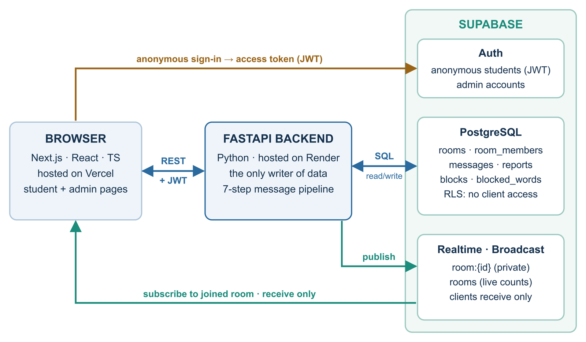
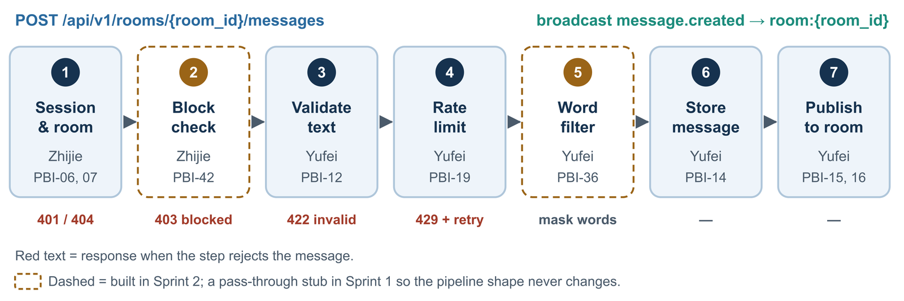

# PlaceChat Technical Design

Final technical plan for Sprints 1 and 2 · CEN3031 Group 4 (10700) · Version 1.4 · October 13, 2026

Prepared by Junhao Li (Product Manager) for Zhijie Yuan, Yufei Xiao, and Chuks Ofojuah.

> [!IMPORTANT]
> **Status: final.** Junhao Li made every decision in this document as Product Manager. Build to it as written.
>
> **Changing a decision.** Open a GitHub issue labeled `design` that explains the problem. Junhao decides; the change lands as a pull request that edits this file and adds a row to the revision history. Until then, the document stands.

## Contents

1. [Summary](#1-summary)
2. [Scope and product rules](#2-scope-and-product-rules)
3. [Architecture](#3-architecture)
4. [Message pipeline](#4-message-pipeline)
5. [Data model](#5-data-model)
6. [Identity and security](#6-identity-and-security)
7. [API and realtime contract](#7-api-and-realtime-contract)
8. [Repository, libraries, and conventions](#8-repository-libraries-and-conventions)
9. [Environments, deployment, and CI](#9-environments-deployment-and-ci)
10. [Delivery plan](#10-delivery-plan)
11. [Settings](#11-settings)
12. [One-time setup (Junhao)](#12-one-time-setup-junhao)
13. [References and revision history](#13-references-and-revision-history)

## 1. Summary

**Key decisions**

- We build the 16 user stories in Epics A–E. Optional accounts, friends, direct messages, and announcements are future extensions. They are not part of Sprints 1–2.
- **Frontend:** Next.js + React + TypeScript + Tailwind CSS, hosted on Vercel.
- **Backend:** FastAPI (Python 3.13), hosted on Render.
- **Data, identity, and live updates:** Supabase PostgreSQL, Supabase Auth (anonymous sign-ins for students, email/password for admins), and Supabase Realtime Broadcast.
- **FastAPI is the only component that writes data.** Browsers call FastAPI over REST and only receive Realtime events for the rooms they joined.
- Every chat message goes through the same **7-step pipeline** inside FastAPI before anyone sees it ([Section 4](#4-message-pipeline)).
- [Section 2.2](#22-product-rules) answers every open question from the user stories, and [Section 11](#11-settings) lists every configurable value.

### 1.1 What changed from the Module 6 architecture document

The Module 6 document proposed a stack before we chose one. Its layered, modular-monolith structure still applies. This document replaces its technology table and its WebSocket gateway:

| Topic | Module 6 document | This document |
|---|---|---|
| Backend language | Node.js + TypeScript | FastAPI (Python) |
| Live updates | WebSocket gateway inside the backend (WSS) | Supabase Realtime Broadcast: FastAPI publishes, browsers receive |
| Browser ↔ backend | HTTPS JSON + WSS | HTTPS REST only |
| Anonymous session | Own AnonymousSession table | Supabase anonymous users (one per browser) |
| Data model | Room, AnonymousSession, Message, Report, AdminUser | Rooms gain category and coordinates; adds room_members, blocks, blocked_words ([Section 5](#5-data-model)) |
| Hosting | Not specified | Vercel (frontend), Render (backend), Supabase (database, Auth, Realtime) |

## 2. Scope and product rules

### 2.1 What we build

The backlog has 47 items worth 149 points, covering 16 stories. Sprint 1 is PBI-01 to PBI-25, and Sprint 2 is PBI-26 to PBI-47:

| Epic | Sprint 1 (walking skeleton) | Sprint 2 |
|---|---|---|
| A · Discover Rooms | A1 Browse rooms | A1 quality check (PBI-38), A2 Live participant count, A3 Nearby rooms first |
| B · Enter a Room | B1 Join without account, B2 Temporary nickname, B3 Leave or switch rooms | B4 Keep nickname after brief disconnect |
| C · Chat in Real Time | C1 Send a message, C2 See messages instantly | C3 Recent history; load test (PBI-44) |
| D · Stay Safe | D1 Flood protection | D2 Report a message, D3 Word filter |
| E · Administer | E1 Manage rooms | E2 Review reports, E3 Temporary block |

### 2.2 Product rules

These are the final answers to the "Conversations" questions in the user stories. Where a rule has a number, the number is a setting ([Section 11](#11-settings)):

| Story | Question | Decision |
|---|---|---|
| A1 | Which rooms exist at launch? | 8–10 University of Florida locations (for example Library West, Marston Science Library, the Reitz Union, Turlington Hall). Junhao picks the list. A migration seeds the rooms, and admins add more later. |
| A1 | What does a room entry show? | Name, short description, category, and participant count, plus distance when sorted by distance. No pictures. |
| A1 | Phone or desktop first? | Mobile-first responsive design. It must work on both. |
| A1, A3 | Default order of the list? | Alphabetical by room name when location is not available. |
| A2 | Exact count or ranges? | Exact count, updated live. |
| A3 | Must a student be near a room to join? | No. Distance only changes the sort order. |
| A3 | What if location permission is denied? | Keep the default order. Nothing else changes. |
| A3 | Do we store a student's location? | Never. The browser sorts locally, and location is never sent to the server. |
| A3 | How are nearby rooms recommended? | A "Near you" section at the top lists rooms within 500 m. Every other room follows, nearest first, with an approximate distance ("about 300 m", "1.2 km"). Location comes from the phone's GPS when available, falling back to Wi-Fi or network location. |
| B1 | How do we tell sessions apart? | Each browser gets a Supabase anonymous user ([Section 6.1](#61-student-identity-supabase-anonymous-sign-ins)). |
| B1 | Show a community-rules notice? | Yes, as a one-line reminder above the message box. No blocking pop-up. |
| B2 | What do nicknames look like? | Adjective + animal, such as "Quiet Otter". A number is added only if every combination is taken. |
| B2 | One nickname everywhere, or per room? | Per room. Each room gives its own nickname. |
| B2 | Can students re-roll their nickname? | No. |
| B3 | Can one person be in several rooms? | Yes, one room per browser tab. |
| B3, B4 | When is a nickname released? | Immediately after an explicit Leave. After a disconnect or closed tab, it is held for 60 seconds. |
| C1 | Maximum message length? | 500 characters, counted after trimming spaces. The input shows a counter. |
| C1 | Emoji and links? | Emoji yes. Links display as plain text and are not clickable. |
| C1 | Edit or delete own messages? | No. |
| C2 | Should new messages pull a scrolled-up reader down? | No. Show a "New messages" button instead. |
| C2 | What does the user see when the connection drops? | A "Connection lost, reconnecting…" banner, then "Reconnected". Missed messages are fetched automatically. |
| C3 | How much history, and kept for how long? | The newest 20 messages, from the last 7 days. Older messages cannot be loaded. |
| D1 | What counts as flooding? | More than 5 messages in 10 seconds from one session, across all rooms. |
| D1 | Block repeated identical messages? | No separate rule; the rate limit covers it. |
| D1 | What is the limit tied to? | The anonymous session, so refreshing or opening new tabs does not reset it. |
| D2 | Does the reporter choose a reason? | Optional: harassment, spam, or other. |
| D2 | Auto-hide after many reports? | No. Only admins remove messages. |
| D3 | Mask or block? | Mask: each blocked word becomes asterisks. The masked text is what gets stored and shown. |
| D3 | Who maintains the word list? | Admins, on the admin Words page. Staging is seeded with a few test words. |
| E1 | Seed script or admin page? | Both. A migration creates the launch rooms, and the admin page manages them afterward. |
| E1 | How do admins sign in? | Supabase email and password, plus an allow-list ([Section 6.2](#62-administrator-authentication)). |
| E1 | What happens when a room is archived? | It disappears from the list. People inside see "This room was closed" and return to the list. Its history is kept but hidden. |
| E2 | How do admins notice new reports? | The admin Reports page shows a pending count and refreshes every 30 seconds. |
| E2 | Delete removed messages, or keep them? | Keep them hidden for the record (`removed_at` is set). Nothing is hard-deleted in Sprints 1–2. |
| E3 | What exactly is blocked? | The anonymous session, never an IP address, so a shared dorm network is never blocked. Clearing browser data escapes a block, and we accept that for this version. |
| E3 | How long do blocks last? | The admin picks 15 minutes, 1 hour, or 24 hours. Blocks cannot be lifted early in this version. |

### 2.3 Not built in Sprints 1–2

- Student accounts and sign-up, friends, and direct messages. These have no stories or PBIs yet.
- Student-organization announcements, and permanent bans.
- Images, files, clickable links, message editing or deleting, and loading history older than the newest 20 messages.
- Native mobile apps. We build one responsive website.

## 3. Architecture

### 3.1 Components and data flow



*Figure 1. Components and data flow.*

1. On first visit, the browser signs in anonymously with Supabase Auth and sends the resulting access token with every REST call.
2. FastAPI verifies the token, applies the business rules, and reads and writes PostgreSQL. No other component writes to the database.
3. When other people need to see a change, FastAPI publishes a Realtime Broadcast event. Examples are a new message, a removed message, or a new participant count.
4. Browsers subscribe to private channels and can only receive. A browser that missed events fetches them again over REST.

### 3.2 Why FastAPI is the only writer

- Moderation cannot be bypassed. Validation, the rate limit, blocks, and the word filter all run in one place.
- Browsers have no access to any table. A leaked publishable key cannot be used to read or change data ([Section 6.6](#66-security-checklist)).
- We test one API surface instead of trusting browser code.

### 3.3 Backend modules and owners

FastAPI is a **modular monolith**: one deployment, split into modules with clear owners. Each request passes through three layers. Routers in `api/` handle HTTP only. Services in `modules/` hold the business rules. The data-access layer runs the SQL. Routers never run SQL, and modules call each other only through the contracts in [Section 3.4](#34-module-contracts).

| Module | Responsibility | Owner | PBIs |
|---|---|---|---|
| `core` | App setup, settings, database connection, error format, health check | Junhao | 01, 05, 13 |
| `core/auth` | Verify access tokens; `get_current_session`; `require_admin` | Zhijie | 06, 21 |
| `core/realtime` | Publish Broadcast events | Yufei | 15 |
| `modules/rooms` | Room list, join and leave, membership, presence and its sweeper, nickname hold | Zhijie | 04, 07, 25, 29, 34, 35 |
| `modules/rooms` (admin) | Create, edit, archive rooms | Junhao | 22 |
| `modules/nicknames` | Generate random nicknames, unique within a room | Yufei | 09, 10 |
| `modules/messaging` | Pipeline steps 3, 6, 7; history; plain-text safety | Yufei | 12, 14, 15, 16, 26, 27 |
| `modules/safety` | Rate limit, reports, word filter (Yufei); temporary blocks (Zhijie) | Yufei, Zhijie | 19, 31, 33, 36, 37; 42, 43 |

### 3.4 Module contracts

These signatures exist in the code as stubs (PBI-01). Each owner replaces their stub in their own PBI; the stub's docstring names the owner and the issue. Functions that touch the database take the request's SQLAlchemy session as their first argument, `db`, so one request can run several modules inside a single transaction.

| Function | Provided by | Used by |
|---|---|---|
| `get_current_session() -> Session` (FastAPI dependency; 401 if the token is missing or invalid) | Zhijie | All student routes |
| `require_admin() -> Admin` (403 if the caller is not an admin) | Zhijie | All /admin routes |
| `generate_nickname(taken: set[str]) -> str` | Yufei | rooms.join (Zhijie) |
| `ensure_member(db, session_id, room_id) -> Membership` (404 if the room is not active, 403 if not joined) | Zhijie | Messaging pipeline |
| `check_not_blocked(db, session_id)` raises `Blocked(until)`; a no-op stub until PBI-42 | Zhijie | Messaging pipeline |
| `check_rate_limit(db, session_id)` raises `RateLimited(retry_after)` | Yufei | Messaging pipeline |
| `filter_text(text) -> str`; returns the text unchanged until PBI-36 | Yufei | Messaging pipeline |
| `publish(topic, event, payload)` | Yufei | Messaging, rooms, admin |

## 4. Message pipeline

Sending a message is the most important flow in the product. Every message passes through these seven steps, in this order:



*Figure 2. The seven steps inside FastAPI, with owners and backlog items.*

- The pipeline stops at the first failing step. A rejected message is never stored or broadcast, and the sender gets an error from [Section 7.2](#72-error-format).
- **Store first, then publish.** If publishing fails, FastAPI logs the error and the message stays in history, so browsers recover it on their next fetch.
- Text is trimmed, filtered, and stored. It is always displayed as plain text; the frontend never uses `dangerouslySetInnerHTML`. This meets the "cannot run code" criterion in C1 and C2.
- The broadcast payload is `id`, `room_id`, `nickname`, `body`, and `created_at`, and **never** includes `session_id`. A session id would let anyone link one person's messages across rooms.
- Each message goes only to its own `room:{room_id}` channel, so it never appears in another room (C2).
- To mark a student's own messages, the frontend uses the message id returned by the POST and the `is_mine` flag in history results. Nicknames alone are not enough, because a nickname can be reused after someone leaves.

## 5. Data model

### 5.1 Tables

All tables live in Supabase PostgreSQL in the `public` schema, and every table has **Row Level Security enabled with no policies**, so browsers can never read or write them directly. Migration files ([Section 8](#8-repository-libraries-and-conventions)) are the source of truth for the exact columns.

| Table | Key columns | Notes (stories) |
|---|---|---|
| rooms | id (uuid), name (unique), description, category, latitude, longitude, status (active or archived), created_at, updated_at | Categories: library, dining, student life, academic, recreation. Coordinates support A3. |
| room_members | room_id, session_id (primary key: both), nickname, joined_at, last_seen_at, left_at | One row per student per room. Drives presence, counts, and nicknames (A2, B2–B4). |
| messages | id (uuid), room_id, session_id, nickname, body, created_at, removed_at, removed_by | Indexes on (room_id, created_at) and (session_id, created_at). |
| reports | id, message_id, room_id, reporter_session_id, reason (harassment, spam, other, or null), status (pending, removed, or dismissed), created_at, handled_at, handled_by | Unique (message_id, reporter_session_id): each person can report a message only once (D2). |
| blocks | id, session_id, reason, created_by, created_at, expires_at | Active while expires_at is in the future (E3). |
| blocked_words | id, word (unique, lowercase), created_at | Edited on the admin Words page (D3). |
| admin_users | user_id (Supabase Auth user id), display_name, created_at | Allow-list of administrators (E1). |

`session_id` is the Supabase anonymous user id. We store no names, emails, IP addresses, or locations for students (B1, A3).

### 5.2 Rules the code must follow

- **Present in a room** means `left_at` is null and `last_seen_at` is within the last 30 seconds. Participant counts use this rule.
- **Nickname reserved** means `left_at` is null and `last_seen_at` is within the last 60 seconds. If the same session rejoins in that window, it gets the same nickname back (B4). An explicit Leave sets `left_at`, which frees the nickname immediately.
- **Joining** runs in one transaction that first takes `pg_advisory_xact_lock` on the room. Two people joining at the same moment can therefore never get the same nickname.
- **Rate limit:** count the session's messages from the last 10 seconds. At 5 or more, reject the message and set `retry_after` to (oldest message time + 10 s − now).
- **Visible history:** the room's messages where `removed_at` is null and `created_at` is within 7 days. Take the newest 20 and return them oldest first.
- **Presence sweeper:** a background task in FastAPI runs every 10 seconds. It finds members who just went past the 30-second presence timeout, then broadcasts the new counts. The backend runs as a single instance, so one sweeper is enough.

## 6. Identity and security

### 6.1 Student identity: Supabase anonymous sign-ins

- On first visit, the frontend calls `supabase.auth.signInAnonymously()`. Students never enter a name, email, or password (B1).
- Supabase keeps the session in the browser. Refreshing or opening a new tab keeps the same identity, which B4's nickname hold and D1's rate limit depend on.
- Anonymous users get the `authenticated` role, and their token has `is_anonymous: true`. Every REST call sends `Authorization: Bearer <access token>`, and FastAPI uses the token's `sub` as `session_id`.
- Supabase limits anonymous sign-ins to **30 per hour per IP address** by default. Many students on campus Wi-Fi share one public IP, so we raise the limit to **300 per hour per IP**. We add Cloudflare Turnstile only if we see abuse.

### 6.2 Administrator authentication

Admins sign in at `/admin/login` with a Supabase email-and-password account. Junhao creates these accounts in the Supabase dashboard, and there is no public admin sign-up page. FastAPI treats a caller as an admin only if the token is **not** anonymous **and** its `sub` is in `admin_users`.

### 6.3 Verifying tokens in FastAPI

- The Supabase projects use an **asymmetric JWT signing key (ES256)**. If a project still uses the legacy shared secret, switch it under JWT Keys before PBI-06.
- FastAPI verifies tokens with PyJWT's `PyJWKClient` against `https://<project>.supabase.co/auth/v1/.well-known/jwks.json`, which caches the keys. It checks the signature, `exp`, `aud = authenticated`, and `iss = <SUPABASE_URL>/auth/v1`.
- supabase-js refreshes tokens automatically. The frontend reads the current session before every API call and never caches the token itself.

### 6.4 Keys and secrets

We use Supabase's **new API keys**. The legacy `anon` and `service_role` keys are being retired by the end of 2026, so we never use them.

| Key | Used by | Secret? |
|---|---|---|
| Publishable key (`sb_publishable_…`) | Frontend (Vercel): Auth and Realtime subscriptions | No. It is public by design, and safe because Row Level Security blocks every table. |
| Secret key (`sb_secret_…`) | Backend (Render) only: Realtime broadcasts | Yes. Supabase rejects it from browsers. Never put it in frontend code, a PR, or chat. |
| `DATABASE_URL` (with database password) | Backend and the migration workflow only | Yes. |

Share secret values privately. Commit only `.env.example` files containing variable names, never values.

### 6.5 Realtime authorization

- In the Supabase dashboard, turn **off** "Allow public access" under Realtime Settings, so every channel is private.
- Browsers join with `supabase.channel(topic, { config: { private: true } })`. supabase-js sends the user's token to Realtime automatically.
- FastAPI publishes with Realtime's REST endpoint `POST /realtime/v1/api/broadcast/{topic}/events/{event}?private=true`. It URL-encodes the topic and sends the secret key in the `apikey` header. The week-1 spike confirms this call end to end.
- We do **not** use the database function `realtime.send()`. It fails when no client has connected yet that day.

A migration adds this single policy. With no insert policy, browsers can receive but never send:

```sql
create policy "signed-in users receive PlaceChat broadcasts"
on realtime.messages for select to authenticated
using (
  realtime.messages.extension = 'broadcast'
  and ((select realtime.topic()) = 'rooms'
       or (select realtime.topic()) like 'room:%')
);
-- Never put "alter table realtime.messages enable row level security" in a
-- migration: RLS is already on, and the statement fails and aborts the migration.
```

### 6.6 Security checklist

- Row Level Security is on for every `public` table, with no policies.
- Realtime is private-only, and browsers have receive-only access.
- Every admin route goes through `require_admin`. Hiding admin pages is not protection.
- CORS on FastAPI allows only our Vercel domains and `http://localhost:3000`.
- Location never leaves the browser, and student IP addresses are never stored.
- Message bodies are always rendered as text, never as HTML.

## 7. API and realtime contract

### 7.1 REST endpoints (prefix /api/v1)

FastAPI publishes interactive docs at `/docs`. The frontend generates its TypeScript types from FastAPI's OpenAPI schema with `openapi-typescript`, and CI fails if the generated types are out of date. Everything except `GET /rooms` and `GET /health` requires a token.

| Method and path | Purpose | Stories | Owner |
|---|---|---|---|
| `GET /rooms` (no token) | Active rooms: name, description, category, coordinates, participant count | A1–A3 | Zhijie |
| `POST /rooms/{room_id}/join` | Join; returns the room and the nickname (the same one when rejoining within the hold time) | B1, B2, B4 | Zhijie |
| `POST /rooms/{room_id}/heartbeat` | Keep presence alive; sent every 15 s | A2, B3 | Zhijie |
| `POST /rooms/{room_id}/leave` | Leave the room and free the nickname | B3 | Zhijie |
| `GET /rooms/{room_id}/messages?after={id}` | Newest 20 visible messages, or only those after `{id}` (used to fill a gap after reconnecting) | C3, B4 | Yufei |
| `POST /rooms/{room_id}/messages` | Send a message through the pipeline ([Section 4](#4-message-pipeline)) | C1, C2, D1 | Yufei |
| `POST /messages/{message_id}/reports` | Report a message, with an optional reason | D2 | Yufei |
| `POST /admin/rooms` · `PATCH /admin/rooms/{id}` · `POST /admin/rooms/{id}/archive` | Create, edit, and archive rooms | E1 | Junhao |
| `GET /admin/reports?status=pending` | Pending reports with message, room, and time | E2 | Yufei |
| `POST /admin/reports/{id}/remove-message` · `POST /admin/reports/{id}/dismiss` | Handle a report. Removing a message also resolves its other pending reports. | E2 | Yufei |
| `POST /admin/blocks` | Block the sender of a reported message: `report_id` plus `duration_minutes` (15, 60, or 1440) | E3 | Zhijie |
| `GET` · `POST` · `DELETE /admin/blocked-words` | Maintain the word list | D3 | Yufei |
| `GET /health` (no token, no prefix) | Health check for Render | — | Junhao |

### 7.2 Error format

Every error returns the same JSON shape, and the frontend shows `message` to the user. This also covers the rate-limit warning in PBI-20:

```json
{ "error": { "code": "RATE_LIMITED",
             "message": "You are sending messages too fast. Try again in 7 seconds.",
             "retry_after": 7 } }
```

| Code | HTTP | When |
|---|---|---|
| `UNAUTHENTICATED` | 401 | Missing, invalid, or expired token |
| `FORBIDDEN` | 403 | Not an admin |
| `NOT_A_MEMBER` | 403 | Sending to a room you have not joined |
| `BLOCKED` | 403 | Sender is blocked; includes `until` |
| `CANNOT_REPORT_OWN` | 403 | Reporting your own message |
| `ROOM_NOT_FOUND` | 404 | Room does not exist or is archived |
| `ALREADY_REPORTED` | 409 | The same person reports the same message twice |
| `VALIDATION_FAILED` | 422 | Empty, whitespace-only, or over-length message, or another invalid input |
| `RATE_LIMITED` | 429 | Over the sending limit; includes `retry_after` |

### 7.3 Realtime events

| Channel | Event | Payload | Sent when |
|---|---|---|---|
| `room:{room_id}` | `message.created` | id, room_id, nickname, body, created_at | A message is stored |
| `room:{room_id}` | `message.removed` | id | An admin removes a message (E2) |
| `room:{room_id}` | `presence.updated` | count | Someone joins, leaves, or times out |
| `room:{room_id}` | `room.archived` | room_id | An admin archives the room (E1) |
| `rooms` | `room.count` | room_id, count | A room's participant count changes (A2) |
| `rooms` | `room.changed` | room_id | An admin creates, edits, or archives a room |

### 7.4 Pages

| Route | Page | Stories | Owner |
|---|---|---|---|
| `/` | Room list: "Near you" section, distance sort, live counts | A1–A3 | Chuks |
| `/rooms/[roomId]` | Chat room: messages, input with counter, status banner, report action, leave | B1–B4, C1–C3, D1, D2 | Chuks |
| `/admin/login` | Admin sign-in | E1 | Chuks |
| `/admin/rooms` | Create, edit, archive rooms | E1 | Chuks |
| `/admin/reports` | Pending reports: remove, dismiss, block sender | E2, E3 | Chuks (block button: Zhijie) |
| `/admin/words` | Blocked-word list | D3 | Yufei, using Chuks's admin layout |

When a backend owner's PBI needs a small UI piece, such as the block button or the Words page, that owner builds it with Chuks's components and Chuks reviews the PR.

### 7.5 Frontend behavior

- **Connection status (C2, PBI-17).** Watch the channel status (`SUBSCRIBED`, `CHANNEL_ERROR`, `TIMED_OUT`, `CLOSED`) and show the banner from [Section 2.2](#22-product-rules). After reconnecting, call `GET /messages?after={last_id}`.
- **Presence (A2, B3).** Send a heartbeat every 15 seconds while the room page is open. Call Leave when the user clicks Leave or navigates to another room. Unsubscribe from the channel on leave.
- **Nearby rooms (A3, PBI-40/41).** Show a "Show rooms near me" button; the browser asks for location permission on the first click. If the Permissions API later reports `granted`, locate automatically on each visit with no prompt.
- **GPS fix.** Call `getCurrentPosition` once per visit with `enableHighAccuracy: true` (asks the device for GPS), `timeout` 10 s, `maximumAge` 1 minute. If it times out, which is common indoors, retry once with `enableHighAccuracy: false` and use that result. Show "Finding rooms near you…" while waiting. Never use `watchPosition`: one fix per visit is enough and saves battery.
- **Recommending.** Compute each room's distance with the haversine formula. Rooms within 500 m go in a "Near you" section at the top; all other rooms follow, nearest first. Show rounded distances: nearest 50 m below 1 km, one decimal in km above. Every room stays joinable.
- **Poor or no location.** If the reported accuracy is worse than 1 km (a desktop located by IP, or an iPhone with Precise Location turned off), sort by distance but hide the "Near you" section, and suggest turning on precise location. If permission is denied or location fails, keep alphabetical order and show no error beyond a short note.
- **Data fetching.** Use a small `apiFetch` helper that adds the token and turns errors into the [Section 7.2](#72-error-format) format. No extra data-fetching library.

## 8. Repository, libraries, and conventions

### 8.1 Repository layout

One repository holds everything. PBI-01 creates this skeleton:

```text
PlaceChat-Team/
├── frontend/                 Next.js app (App Router)
│   ├── src/app/              routes from Section 7.4
│   ├── src/components/
│   ├── src/lib/              apiFetch, Supabase client, generated API types
│   ├── .env.example
│   └── package.json
├── backend/                  FastAPI app
│   ├── app/
│   │   ├── main.py
│   │   ├── api/              routers (HTTP only)
│   │   ├── core/             settings, db, auth, errors, realtime
│   │   └── modules/          rooms/, nicknames/, messaging/, safety/
│   ├── tests/
│   ├── .env.example
│   ├── .python-version       3.13
│   └── pyproject.toml
├── docs/                     this document and its images (docs/course/ stays local)
├── supabase/migrations/      schema, RLS, Realtime policy, launch rooms
├── tools/loadtest/           PBI-44 load test script
├── .github/workflows/        ci.yml, migrate.yml
├── CONTRIBUTING.md
└── README.md
```

### 8.2 Libraries

| Area | Libraries |
|---|---|
| Frontend | Next.js (App Router), React, TypeScript (strict), Tailwind CSS, @supabase/supabase-js. Dev: ESLint, Prettier, Vitest, openapi-typescript. Node.js 24. |
| Backend | FastAPI, Uvicorn, Pydantic v2 + pydantic-settings, SQLAlchemy 2, psycopg 3, PyJWT (with cryptography), httpx. Dev: pytest, ruff, httpx2 (for Starlette's test client). Python 3.13. |
| Database tooling | Supabase CLI for migrations |

### 8.3 Conventions

- **Sync FastAPI.** Endpoints are plain `def` functions using synchronous SQLAlchemy and psycopg; FastAPI runs them in its thread pool. That is simpler than async and plenty fast for our load. Use a connection pool of 5.
- **Pydantic models** for every request and response body. **ruff** for linting and formatting, and type hints throughout.
- **Settings** come from environment variables through pydantic-settings, and none are hard-coded ([Section 11](#11-settings)).
- **Database changes** happen only through new SQL files in `supabase/migrations/`. Never edit the schema by hand in the dashboard, and never edit a migration that is already merged.
- **Branches, commits, and PRs** follow [CONTRIBUTING.md](../CONTRIBUTING.md).

## 9. Environments, deployment, and CI

### 9.1 Environments

| Environment | Frontend | Backend | Database | Deployed from |
|---|---|---|---|---|
| Local | `npm run dev` (port 3000) | `uvicorn app.main:app --reload` (port 8000) | Staging project, or your own free Supabase project when testing a new migration | Your branch |
| Preview | Vercel preview per PR | Staging backend | Staging | Every PR |
| Staging | Vercel, fixed staging domain | Render `placechat-api-staging` (free) | Supabase `placechat-staging` | `main`, on every merge |
| Production | Vercel production | Render `placechat-api` (paid) | Supabase `placechat-prod` | `release`, at PBI-45–47 |

### 9.2 Hosting setup

- **Region:** Supabase projects in East US (North Virginia), and Render services in Virginia. Keeping them close keeps message delivery under 1 second.
- **Vercel:** one project with root directory `frontend`, and `release` as the production branch. `main` gets a fixed staging domain. The Preview environment variables point to staging, and the Production variables point to production.
- **Render:** two web services with root directory `backend`. Start command: `uvicorn app.main:app --host 0.0.0.0 --port $PORT`. Health check: `/health`. Python is pinned to 3.13, because Render otherwise uses its newer default.
- **Database connection:** use Supabase's **session pooler** connection string on port 5432. It works over IPv4. The direct connection is IPv6-only unless we buy Supabase's IPv4 add-on, so we don't rely on it.
- **Release:** a pull request from `main` into `release`. The `protect-main` ruleset is extended to cover `release`.

### 9.3 Free tiers and cost

- Render free services sleep after 15 minutes without traffic and take about a minute to wake. Staging stays free, and we accept the sleep: open the site once and wait for it to wake before checkpoints and tests.
- Production runs on Render's **cheapest paid instance**, which never sleeps, from PBI-45 until the course ends. This is our only expected cost. Without a budget, production would also run free, with a keep-warm ping on demo days only. We cannot ping both services all month, because the 750 free hours per workspace would run out.
- Supabase free projects pause after about a week without activity, and the free plan allows two active projects, which is exactly staging plus production. Check that staging is active before demos.

### 9.4 Environment variables

| Where | Variables (names only; values are shared privately) |
|---|---|
| Frontend (Vercel) | `NEXT_PUBLIC_API_BASE_URL`, `NEXT_PUBLIC_SUPABASE_URL`, `NEXT_PUBLIC_SUPABASE_PUBLISHABLE_KEY` |
| Backend (Render) | `DATABASE_URL`, `SUPABASE_URL`, `SUPABASE_SECRET_KEY`, `CORS_ORIGINS`, plus the settings in [Section 11](#11-settings) |
| GitHub Actions secrets | `SUPABASE_STAGING_DB_URL` (the staging session pooler connection string, the same value as the backend's `DATABASE_URL`), plus `SUPABASE_PRODUCTION_DB_URL` in a `production` environment |

### 9.5 Continuous integration (PBI-02)

`ci.yml` runs on every pull request and every push to `main` or `release`:

| Job | Steps |
|---|---|
| frontend | Node.js 24 → `npm ci` → lint → type-check → Vitest → `next build` |
| backend | Python 3.13 → install → `ruff check` → `ruff format --check` → `pytest` |
| api-types | Export FastAPI's OpenAPI schema → regenerate the frontend types → fail if they differ from the committed file |

- Once all three jobs pass, they become **required status checks** in the ruleset, alongside the one required review.
- `migrate.yml` runs `supabase db push` against staging on every push to `main` that changes `supabase/migrations/`. At release, Junhao runs it manually against production.

### 9.6 Testing

- **Backend:** unit tests for every pipeline step and module contract, using fakes for the database and Realtime. API tests use FastAPI's `TestClient`. Every endpoint has at least one success test and one failure test.
- **Frontend:** Vitest for pure logic (distance sorting, error messages, time formatting), plus lint, type-check, and build.
- **Staging checkpoints** (PBI-18, PBI-39) walk through each story's acceptance criteria as a checklist.
- **Load test** (PBI-44): a Node.js script in `tools/loadtest/` connects 50 anonymous clients to one room. Delivery must stay under 1 second at the 95th percentile, and the room list must load in under 2 seconds with the backend awake.

## 10. Delivery plan

### 10.1 Sprints and assignments

There are two 3-week sprints: Sprint 1 runs October 2–22 and Sprint 2 runs October 23 – November 12. The required velocity is 74.5 points per sprint, and capacity is 48 team-hours per sprint. The project board is the live source for status.

| Sprint | Junhao | Chuks | Zhijie | Yufei | Points |
|---|---|---|---|---|---|
| Sprint 1 (PBI-01 – 25) | 01, 02, 05, 13, 18, 22 (17) | 03, 08, 11, 17, 20, 23, 24 (16) | 04, 06, 07, 21, 25 (19) | 09, 10, 12, 14, 15, 16, 19 (21) | 73 |
| Sprint 2 (PBI-26 – 47) | 39, 44, 45, 46, 47 (14) | 28, 30, 32, 38, 40, 41 (17) | 29, 34, 35, 42, 43 (21) | 26, 27, 31, 33, 36, 37 (24) | 76 |
| Total | 31 | 33 | 40 | 45 | 149 |

### 10.2 Order of work in Sprint 1

| Week | Focus | Items |
|---|---|---|
| 1 | Foundation and spike | PBI-01 skeleton and contract stubs, PBI-02 CI, PBI-05 platforms and staging (Junhao). Schema for rooms, room_members, and messages. PBI-04 + PBI-03 room list end to end. PBI-06 anonymous session. **Spike** (Zhijie + Yufei, about 2 hours): anonymous sign-in → FastAPI verifies the token → FastAPI broadcasts to a private channel → the browser receives it. This tests risk R3 first. |
| 2 | Join and chat | PBI-07, 09, 10 join and nicknames. PBI-08, 11 room and chat UI. PBI-12, 14, 15, 16 pipeline steps 3, 6, 7. PBI-13 frontend connected to the APIs. |
| 3 | Safety, admin, checkpoint | PBI-18 checkpoint on staging, early in the week. PBI-17 connection status. PBI-19, 20 rate limit and warning. PBI-21 admin auth, PBI-22 admin rooms API, PBI-23 admin UI. PBI-24, 25 leave and switch rooms. |

### 10.3 Definition of Done

- The pull request is reviewed and merged according to CONTRIBUTING.md, with all required checks green.
- The related story's acceptance criteria are checked.
- It is deployed to staging and smoke-tested.
- The issue is Done on the project board. Board automation moves it when the linked PR merges.

## 11. Settings

Every number in this document is defined in exactly one place: a backend setting (`backend/app/core/config.py`), a frontend constant, or a Supabase dashboard setting:

| Setting | Value | Story |
|---|---|---|
| `MESSAGE_MAX_LENGTH` | 500 characters | C1 |
| `RATE_LIMIT_MAX_MESSAGES` / `RATE_LIMIT_WINDOW_SECONDS` | 5 messages / 10 seconds | D1 |
| Heartbeat interval (frontend constant) | 15 seconds | A2, B3 |
| `PRESENCE_TIMEOUT_SECONDS` | 30 | A2 |
| `NICKNAME_HOLD_SECONDS` | 60 | B4 |
| `HISTORY_LIMIT` / `MESSAGE_RETENTION_DAYS` | 20 messages / 7 days | C3 |
| `BLOCK_DURATION_OPTIONS_MINUTES` | 15, 60, 1440 | E3 |
| `SWEEPER_INTERVAL_SECONDS` | 10 | A2 |
| Admin reports refresh (frontend constant) | 30 seconds | E2 |
| "Near you" radius / accuracy cutoff / GPS timeout (frontend constants) | 500 m / 1 km / 10 s | A3 |
| Anonymous sign-ins per IP (Supabase dashboard) | 300 per hour | B1 |

## 12. One-time setup (Junhao)

These platform and board tasks belong to PBI-01, PBI-02, and PBI-05:

| Where | Task |
|---|---|
| Supabase | Create `placechat-staging` in East US (North Virginia). Enable anonymous sign-ins and raise their limit to 300 per hour. Confirm the JWT signing key is ES256. Create the publishable and secret keys. Turn off "Allow public access" in Realtime Settings. Create the admin accounts and their `admin_users` rows. |
| Render | Create `placechat-api-staging` (free, Virginia, branch `main`, root `backend`, health check `/health`, Python 3.13). Create `placechat-api` (paid) at PBI-45. |
| Vercel | Import the repository with root directory `frontend`. Set the production branch to `release`, give `main` a fixed staging domain, and set the Preview and Production environment variables. |
| GitHub | Add the Actions secrets ([Section 9.4](#94-environment-variables)). Extend `protect-main` to cover `release`. Make the three CI jobs required checks once they pass. |

## 13. References and revision history

- Course documents (User Stories & Story Map, Product Backlog, Module 6 Software Architecture Models, Project Design and Planning Presentation) are not in this repository; ask Junhao for a copy.
- Repository: [CONTRIBUTING.md](../CONTRIBUTING.md), pull request template. Work is tracked on the PlaceChat Team Board.
- Supabase documentation: Anonymous Sign-Ins, JWT Signing Keys, API Keys, Realtime Authorization, Realtime Broadcast, and Connecting to Postgres. Render documentation: Free Instances and Python Version.

| Version | Date | Changes |
|---|---|---|
| 1.0 | Oct 7, 2026 | First draft, with proposals and open decisions |
| 1.1 | Oct 7, 2026 | Final. Every decision made, and Supabase/Render details checked against current docs: new API keys, JWKS verification, session pooler, Realtime REST broadcast. Product rules added, retention set to 7 days, setup checklist added. |
| 1.2 | Oct 7, 2026 | A3 refined (Sprint 2): "Near you" section within 500 m, GPS-based location with Wi-Fi/network fallback, approximate distances, automatic sorting once permission is granted. All rooms remain joinable. |
| 1.3 | Oct 11, 2026 | Moved into the repository as Markdown; this file is now the only maintained copy. Module contracts take `db` as their first argument when they touch the database. Section 10 lists the final assignments only. |
| 1.4 | Oct 13, 2026 | The migration workflow connects with the session pooler connection string (`supabase db push --db-url`) instead of a Supabase access token and `supabase link`, which needs read access to many unrelated project settings. Its GitHub secrets are now one connection string per environment (Section 9.4). |
